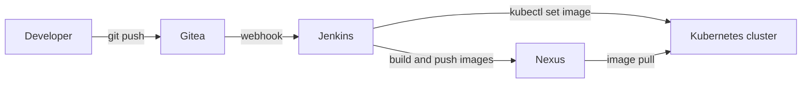

# Automated Kubernetes Cluster with Self-Hosted CI/CD

A complete Kubernetes platform built on a laptop from code only. **Vagrant** creates three VMs, **Ansible** configures them, and a self-hosted toolchain (**Gitea**, **Nexus**, **Jenkins**) turns every `git push` into a new deployment on the cluster.

A small sample application (Flask API + MySQL + nginx front end) is deployed to show the whole flow working end to end.

## What you get

| Component | Role | Where it runs |
|---|---|---|
| Vagrant + VirtualBox | Creates and networks the 3 VMs | Host machine |
| Ansible | Provisions every layer (7 roles) | `vm-service` |
| Gitea | Git server hosting the app repository | `vm-service` (Docker) |
| Nexus | Private Docker registry | `vm-service` (Docker) |
| NFS server | Shared storage backing Kubernetes volumes | `vm-service` |
| Kubernetes 1.31 | kubeadm cluster, CRI-O runtime, Calico networking, metrics-server | `control-plane` + `worker-1` |
| NFS provisioner (Helm) | Default StorageClass (`nfs-client`) | Cluster |
| Jenkins (Helm) | CI/CD, configured as code (JCasC) | Cluster, exposed on `worker-1` |
| Sample app | Flask API + MySQL 8 + nginx front end | Cluster, namespace `app-registre` |

## Architecture



| VM | IP | Role |
|---|---|---|
| `vm-service` | 192.168.56.10 | Ansible controller, Gitea, Nexus, NFS server |
| `control-plane` | 192.168.56.11 | Kubernetes control plane |
| `worker-1` | 192.168.56.12 | Kubernetes worker, application pods |

## CI/CD flow

1. A push to the `main` branch of the `app` repository in Gitea fires a webhook to Jenkins.
2. Jenkins starts a temporary agent pod in the cluster (inbound agent, Docker-in-Docker, kubectl).
3. The `app-pipeline` job runs four stages: **Checkout**, **Build Backend**, **Build Frontend**, **Deploy**.
4. Images are pushed to Nexus as `k8s-cluster/backend:<build>` and `k8s-cluster/frontend:<build>`.
5. The Deploy stage runs `kubectl set image` on the `backend` and `frontend` deployments in the `app-registre` namespace.

## Sample application

A small "people registry" with a Flask REST API and an nginx-served web page.

| Method | Endpoint | Description |
|---|---|---|
| GET | `/api/health` | Health check (used by the readiness probe) |
| GET | `/api/personnes` | List people |
| POST | `/api/personnes` | Add a person (`nom`, `prenom`) |
| DELETE | `/api/personnes/<id>` | Delete a person |

- Backend and frontend each run **2 replicas**.
- MySQL 8 runs as a StatefulSet with a 5 Gi persistent volume on NFS.
- nginx serves the page and proxies `/api/` to the `backend` service.
- Database credentials are stored in a Kubernetes Secret.

## Prerequisites

- [VirtualBox](https://www.virtualbox.org/)
- [Vagrant](https://www.vagrantup.com/)
- A host able to give the VMs about **9 GB of RAM and 6 vCPUs** in total (2 vCPU / 2 GB for `vm-service`, 2 / 4 GB for `control-plane`, 2 / 3 GB for `worker-1`; adjustable in `ansible/group_vars/all/main.yml`)
- Internet access from the VMs (packages, Helm charts, container images)

## Getting started

### 1. Clone the repository

```bash
git clone <your-repository-url>
cd K8S
```

### 2. Set your credentials

`ansible/group_vars/all/main.yml` contains placeholders for the six secrets. Do not put real values in a file you commit. Instead, create `ansible/group_vars/all/vault.yml`, which is listed in `.gitignore`. Ansible loads it after `main.yml`, so its values take precedence.

```yaml
# ansible/group_vars/all/vault.yml  (not committed)
vault_gitea_admin_user:       "your-gitea-admin"
vault_gitea_admin_password:   "choose-a-password"
vault_nexus_admin_password:   "choose-a-password"
vault_jenkins_admin_password: "choose-a-password"
vault_mysql_root_password:    "choose-a-password"
vault_mysql_app_password:     "choose-a-password"
```

### 3. Start everything

```bash
vagrant up
```

`vagrant up` creates the VMs in this order: `vm-service`, `control-plane`, `worker-1`. `vm-service` is provisioned first (Docker, NFS, Nexus, Gitea). When `worker-1` comes up, a Vagrant trigger runs the full Ansible playbook from `vm-service` to build the Kubernetes cluster, install Helm, the NFS provisioner and Jenkins, and deploy the application.

The first run downloads many packages and images, so it takes a while.

### 4. Open the services

| Service | URL | Login |
|---|---|---|
| Sample application | http://192.168.56.12:30090 | none |
| Jenkins | http://192.168.56.12:30080 | `admin` / `vault_jenkins_admin_password` |
| Gitea | http://192.168.56.10:3000 | `vault_gitea_admin_user` / `vault_gitea_admin_password` |
| Nexus | http://192.168.56.10:8081 | `admin` / `vault_nexus_admin_password` |

### 5. Try the pipeline

Clone the `app` repository from Gitea, change something in `frontend/index.html`, then commit and push to `main`. Jenkins picks up the push, builds and publishes the new images, and updates the running deployments.

## Configuration

| What | Where |
|---|---|
| IPs, VM CPU/RAM, Vagrant box, Kubernetes version, ports | `ansible/group_vars/all/main.yml` |
| Pod and service CIDRs, Calico version | `ansible/roles/master/defaults/main.yml` |
| Jenkins resources, probes, app replicas, NodePorts, MySQL size | `ansible/roles/jenkins/defaults/main.yml` |
| NFS export path and StorageClass settings | `ansible/roles/tools/defaults/main.yml`, `ansible/roles/nfs/defaults/main.yml` |
| Jenkins plugins and JCasC (credentials, Gitea server, pipeline job) | `ansible/roles/jenkins/templates/jenkins-values.yml.j2` |

## Re-running parts of the setup

Playbook sections are tagged (`service`, `common`, `k8s`, `master`, `worker`, `helm`, `nfs`, `jenkins`). For example, to re-run only the Jenkins and application deployment:

```bash
vagrant ssh vm-service -c "cd /vagrant && ANSIBLE_HOST_KEY_CHECKING=False \
  ansible-playbook -i ansible/inventory.ini ansible/site.yml --tags jenkins"
```

Other useful commands:

```bash
vagrant status          # state of the 3 VMs
vagrant halt            # stop the VMs
vagrant up              # start them again
vagrant destroy -f      # delete everything
```

## Project structure

```
.
├── Vagrantfile                     # 3 VMs, SSH key generation, provisioning trigger
├── ansible/
│   ├── site.yml                    # master playbook
│   ├── inventory.ini
│   ├── ansible.cfg
│   ├── group_vars/all/main.yml     # shared configuration (read by Vagrant and Ansible)
│   └── roles/
│       ├── tools/                  # Docker, NFS server, Nexus, Gitea (+ bootstrap)
│       ├── common/                 # node prerequisites, CRI-O, kubeadm/kubelet/kubectl
│       ├── master/                 # kubeadm init, Calico, metrics-server
│       ├── worker/                 # join the cluster
│       ├── helm/                   # Helm installation
│       ├── nfs/                    # NFS subdir external provisioner
│       └── jenkins/                # Jenkins (Helm), MySQL, app manifests, webhook, RBAC
└── app/
    ├── Jenkinsfile                 # Checkout, Build Backend, Build Frontend, Deploy
    ├── backend/                    # Flask API + Dockerfile
    └── frontend/                   # static page + nginx config + Dockerfile
```

## Tech stack

Vagrant, VirtualBox, Ansible, Kubernetes (kubeadm, CRI-O, Calico), Helm, Jenkins (JCasC), Gitea, Sonatype Nexus, NFS, Docker, Flask, MySQL, nginx.
